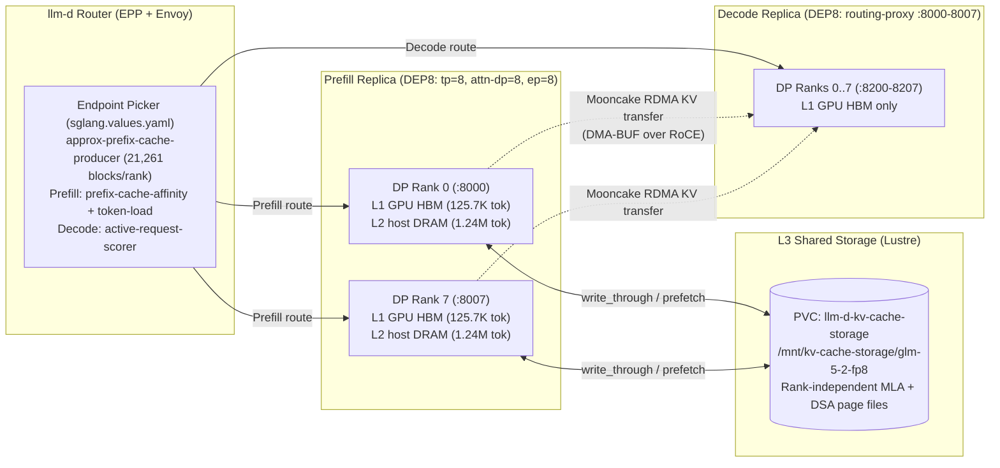

# Serving GLM-5.2 on SGLang with llm-d: Extending Wide-EP Prefix Caching to Host DRAM and Shared Storage

In [Serving GLM-5.2 for Agentic Workloads on llm-d](/blog/serving-glm-5-2-agentic-workloads-on-llm-d), we showed how `llm-d` serves [GLM-5.2-FP8](https://huggingface.co/zai-org/GLM-5.2-FP8) (744B total parameters, 39B active, 78 layers) on NVIDIA H200 GPUs by combining wide expert parallelism (`DEP`), prefill/decode (`P/D`) disaggregation, prefix-cache-aware routing, Multi-Token Prediction (`MTP`), and CPU DRAM offloading. That post closed with a look ahead: extending the KV cache hierarchy beyond per-node CPU DRAM to shared network storage so paused agent sessions, cross-rank overflows, and scaled-out or restarted replicas can restore saved KV state instead of recomputing repository-scale prompts.

This post puts that architecture into practice on the **SGLang** variant of the [GLM-5.2 well-lit path](https://github.com/llm-d/llm-d/tree/main/guides/models/glm-5-2) (`MODEL_SERVER=sglang`), running on Google Kubernetes Engine (GKE) A3 Ultra nodes (`8x NVIDIA H200` per node) paired with `llm-d` Router (via GKE Inference Gateway). Using SGLang's Hierarchical Cache (**HiCache**) on the prefill pool, we evaluate a three-tier KV cache hierarchy under wide expert parallelism (`DEP8`, attention `TP=1, DP=8, EP=8`):

* **L1 GPU HBM:** Per-rank high-bandwidth memory on each prefill GPU (`125,696` tokens per rank, `1.01M` tokens per node) for active prefill chunks and hot prefixes.
* **L2 host DRAM:** Per-rank pinned host memory managed by SGLang HiCache (`--hicache-size`, `64–150 GB` per rank, `9.88M–23.16M` tokens per node), transferring KV and DeepSeek Sparse Attention (`DSA`) indexer pages over PCIe Gen5 at ~45 GB/s.
* **L3 shared storage (Lustre):** SGLang HiCache's file storage backend (`--hicache-storage-backend file`) backed by a `ReadWriteMany` PersistentVolumeClaim on **Google Cloud Managed Lustre** (referred to as **L3 shared storage (Lustre)** throughout this post), providing a single deduplicated cache namespace shared across all attention-DP ranks and prefill replicas.

We benchmark the deployment with both [AIPerf](https://github.com/ai-dynamo/aiperf) (`--scenario inferencex-agentx-mvp` on the SemiAnalysis Weka Claude Code trace corpus, matching the vLLM methodology) and multi-turn trace replay for cold-start and cross-rank session resumption.

<!-- truncate -->

<!-- reading-time-exclude:start -->
<details className="alert alert--success">
<summary><strong>TL;DR: workload, memory math, measured gains, and recipe</strong></summary>

* **Wide-EP (`DEP8`) makes per-node KV capacity additive across ranks.** Because GLM-5.2 uses Multi-Head Latent Attention (`MLA`) with a single compressed KV latent, tensor parallelism (`TP=8`) replicates the same KV cache across all eight GPUs on a node. Running attention data-parallel (`TP=1, DP=8, EP=8`) gives each GPU its own independent KV pool: one 8-GPU H200 prefill node holds **1.01M tokens in L1 GPU HBM** (`125,696` tokens / `6.75 GB` per rank) plus **9.88M tokens in L2 host DRAM** at the default `64 GB/rank` (`540.7 GB` node total including the DSA indexer cache), scaling to **23.16M tokens** at `150 GB/rank`.

* **MLA gives L3 shared storage (Lustre) a rank-independent cache key.** In SGLang's `HiCacheFile` backend, MLA models omit the tensor-parallel rank suffix from page filenames (`<page_hash>_zai-org-GLM-5.2-FP8.bin` and `.indexer.bin`, `3.42 MB` per 64-token page). Every attention-DP rank on a node—and every prefill replica mounting the shared Lustre volume—reads and writes the same deduplicated files without code changes.

* **Prefix-aware routing + L2 host DRAM prevent L1 thrashing and capture >99% of available prefix reuse.** On a 16-GPU `1P1D` (`p1w1d1w1`, `DEP8` prefill + `DEP8` decode) deployment running AIPerf `inferencex-agentx-mvp`, the L1-only baseline's server prefix-cache hit rate drops from `74.2%` at concurrency 8 to `48.4%` at concurrency 16 and collapses to `11.0%` at concurrency 32 (`54.62 s` median TTFT, stalling at `202.8 tok/s` output), and times out during warmup at concurrency 64. Adding L2 host DRAM (`64 GB/rank`, `21,261` 64-token blocks tracked per rank by the `llm-d` Router) sustains a **93.2%–95.2% server-side prefill cache hit rate** through concurrency 32—cutting median TTFT by **79–80%** (`54.62 s -> 11.08–11.23 s`), cutting median turn latency by **73–74%** (`60.66 s -> 15.58–16.24 s`), and raising aggregate input throughput **3.0x** (`23,238 -> 70,928 tok/s`) and output throughput **2.3x** (`202.8 -> 475.8 tok/s`)—while scaling cleanly to concurrency 64 (`585.8 tok/s` output, `0` errors).

* **Write-through to L3 shared storage (Lustre) adds zero steady-state penalty while protecting cold starts, cross-rank routing, and pod restarts.** Across the AIPerf load sweep, asynchronous `write_through` persisted **693,840 files (1.18 TB, 22.2M tokens)** to Lustre while matching L2-only throughput and TTFT within run-to-run variance. When sessions resume on a cold rank or after a prefill pod restart (16 concurrent Weka trace sessions, `90.2K` mean input tokens), restoring from L3 shared storage (Lustre) recovers **100% of the prior turn's prefix (`1.44M` tokens / `74.8 GB`)**, cutting median TTFT by **57%** (`38.84 s -> 16.82 s`, **2.31x faster**) and nearly doubling effective input throughput (`17,274 -> 33,814 tok/s`).

* **Run it.** The composable `hicache` (L2 host DRAM) and `hicache-fs` (L3 shared storage) Kustomize components, benchmark overlays, and per-workload host-tier sizing table are available in [`guides/models/glm-5-2`](https://github.com/llm-d/llm-d/tree/main/guides/models/glm-5-2) (`MODEL_SERVER=sglang`, [llm-d#2924](https://github.com/llm-d/llm-d/pull/2924)).

</details>
<!-- reading-time-exclude:end -->

---

## The shape of agentic traffic

As detailed in the [vLLM GLM-5.2 post](/blog/serving-glm-5-2-agentic-workloads-on-llm-d#the-shape-of-agentic-traffic), interactive coding sessions are dominated by re-reading growing repository context across tool calls and subagent fan-out. In the 393-session [`semianalysisai/cc-traces-weka-062126`](https://huggingface.co/datasets/semianalysisai/cc-traces-weka-062126) corpus (`98,827` total model requests: `56,798` main-agent turns and `42,029` subagent requests across `1,697` parallel groups), each turn appends a small delta—a tool output, file read, or test log—to an existing conversation history:

| **Main-agent metric (`cc-traces-weka-062126`)** | **p50** | **p90** | **p99** |
| :--- | :--- | :--- | :--- |
| Input tokens per request (full corpus, 393 sessions) | 254K | 651K | 898K |
| Input tokens per request (admitted `<=120K` subset, 71 sessions) | 60.5K | 96.4K | 115.6K |
| Output tokens per response | 616 | 3,502 | 10,346 |
| Input-length growth from prior turn | 1,728 | 5,440 | 124.6K |
| Inter-turn think gap (after prior response completes) | 5.1 s | 2.3 min (140 s) | 55.9 min (3,354 s) |
| Wall-clock arrival gap between consecutive turns | 17.2 s | 2.6 min (156 s) | 54.5 min (3,271 s) |
| Turns per session | 65 | 330 | 1,390 |
| Prefix overlap with best recent turn | 99.45% | 99.91% | 100.0% |
| Subagent group fan-out size (`1,697` groups) | 16 | 47 | 175 |

Three properties of this distribution govern how the KV cache hierarchy must be designed:

1. **Prefill dominates compute unless prefixes are cached.** At the median, a main-agent turn reads `254K` input tokens (`60.5K–84.5K` in the `<=120K` single-node subset) and generates `265–616` output tokens, while `95.5%` of turns reuse at least `90%` of their input verbatim from an earlier turn.
2. **Think-time pauses span three orders of magnitude.** While the median pause between a completed response and the next request is `5.1 seconds` (a quick CLI tool execution), the p90 pause is `2.3 minutes` and the p99 pause reaches **55.9 minutes** (developer code review, test suite execution, or context switching).
3. **Subagent bursts and load balancing create cross-rank traffic.** Over `42%` of all corpus requests arrive as fanned-out subagent waves (`16` concurrent requests at the median, `47` at p90) that share a common system/repository prefix or branch from a parent session.

---

## How the SGLang wide-EP deployment works

The SGLang GLM-5.2 recipe in [`guides/models/glm-5-2/modelserver/gpu/sglang`](https://github.com/llm-d/llm-d/tree/main/guides/models/glm-5-2/modelserver/gpu/sglang) deploys a disaggregated prefill and decode (`P/D`) architecture managed by a Kubernetes `DisaggregatedSet` (two `LeaderWorkerSet` pools) behind the `llm-d` Router:



Key architectural choices in the SGLang stack on GKE A3 Ultra (`a3-ultragpu-8g`, 8x H200 141 GB with 8x ConnectX-7 RoCE NICs via Dynamic Resource Allocation):

* **Per-rank Rust HTTP frontend (`SGLANG_RUST_SERVER=1`):** Instead of a single Python API server bottlenecking all 8 ranks, each attention-DP rank runs its own Rust HTTP listener on ports `8000–8007` (prefill) and `8200–8207` behind the local `routing-proxy` on `8000–8007` (decode). The `InferencePool` exposes all eight target ports so the `llm-d` Router schedules directly to individual DP ranks.
* **DeepEP v2 hybrid all-to-all (`--moe-a2a-backend deepep_v2`):** Both prefill and decode run attention data-parallel (`--tp-size 8 --attn-dp-size 8 --ep-size 8`, i.e., `DEP8` with attention `TP=1`) and dispatch MoE tokens across experts using DeepEP v2 over NCCL GIN.
* **DeepSeek Sparse Attention (`DSA`) with FlashMLA (`--dsa-prefill-backend flashmla_kv --dsa-decode-backend flashmla_kv`):** GLM-5.2 pairs MLA with a lightning indexer that selects top-k sparse attention blocks (`page_size=64`). Both the FP8 MLA latent cache and the DSA indexer cache must be preserved across turns and transferred or offloaded together.
* **Mooncake RDMA KV transfer with DMA-BUF:** Prefill transfers newly computed (or restored) KV and indexer pages to decode over GPUDirect RDMA using the Mooncake transfer engine (`--disaggregation-transfer-backend mooncake`). On GKE Container-Optimized OS (COS) with the NVIDIA open kernel module, setting `WITH_NVIDIA_PEERMEM=0` registers GPU memory regions via Linux `DMA-BUF` (`ibv_reg_dmabuf_mr`) rather than legacy `nvidia_peermem`.
* **EAGLE Multi-Token Prediction (`MTP`):** Both roles run 3-step EAGLE speculative decoding (`--speculative-algorithm EAGLE --speculative-num-steps 3 --speculative-num-draft-tokens 4`).

---

## Fitting repository-scale sessions in memory under `DEP8`

### Why data-parallel attention (`DEP8`) replaces `TP=8`

GLM-5.2's Multi-Head Latent Attention (`MLA`) compresses the key-value state of each token into a single shared latent vector (`512` FP8 latent elements + `64` RoPE elements = `576` bytes per layer per token) rather than separate per-head key and value tensors. Because there are no KV heads to partition across tensor-parallel ranks, **standard `TP=8` duplicates identical copies of the MLA KV cache across all 8 GPUs on a node**. Under `TP=8`, storing a single 100K-token conversation consumes `100K` tokens of KV budget on *every* GPU (`800K` physical token slots across the node), and 2 TB of host DRAM across 8 ranks holds only `1/8` as many unique tokens as the raw byte division suggests.

With `DEP8` (`--tp-size 8 --attn-dp-size 8 --ep-size 8`), attention runs at `TP=1` on each GPU while MoE expert weights are sharded across all 8 GPUs via expert parallelism. Each attention-DP rank holds KV state **only for the requests routed to that rank**, so physical KV capacity adds up linearly across all 8 GPUs on the node.

### Measured per-rank and per-node KV capacity on H200

Rather than estimating from parameter counts, we read the exact memory allocations reported by SGLang at startup on an H200 `DEP8` prefill node (`141 GB` HBM3e per GPU, `2.95 TB` host DRAM per node, `--mem-fraction-static 0.85`, `page_size=64`):

| **Memory Tier** | **Per `DEP8` Rank (1x H200)** | **Per `DEP8` Prefill Node (8x H200)** | **What It Holds (from SGLang startup logs)** |
| :--- | :--- | :--- | :--- |
| **Model weights** | `111.13 GB` | `889.0 GB` HBM | `106.09 GB` GLM-5.2-FP8 shard + `5.04 GB` EAGLE MTP draft weights |
| **L1 GPU HBM** | **125,696 tokens** (`1,964` pages, `6.75 GB`) | **1,005,568 tokens** (`15,712` pages, `54.0 GB` HBM) | `6.32 GB` target MLA KV (`78` layers, `50.3 KB/tok`) + `0.09 GB` MTP draft KV + `0.34 GB` DSA indexer (`53.7 KB/tok` combined) |
| **L2 host DRAM (`64 GB` default)** | **1,235,008 tokens** (`19,297` pages, `67.59 GB`) | **9,880,064 tokens** (`154,376` pages, `540.7 GB` DRAM) | `64.00 GB` packed MLA + MTP KV (`79` layers, `51.8 KB/tok`) + `3.59 GB` DSA indexer (`22` layers, `2.9 KB/tok`) |
| **L2 host DRAM (`100 GB` option)** | **1,929,664 tokens** (`30,151` pages, `105.6 GB`) | **15,437,312 tokens** (`241,208` pages, `844.9 GB` DRAM) | `100.0 GB` packed MLA + MTP KV + `5.61 GB` DSA indexer |
| **L2 host DRAM (`150 GB` option)** | **2,894,528 tokens** (`45,227` pages, `158.4 GB`) | **23,156,224 tokens** (`361,816` pages, `1,267.3 GB` DRAM) | `150.0 GB` packed MLA + MTP KV + `8.41 GB` DSA indexer |
| **L3 shared storage (Lustre)** | Shared namespace (`3.42 MB` / 64-tok page) | **~163M tokens** on an `8.7 TiB` volume | Two files per 64-token page: `3.24 MB` `.bin` (MLA+MTP KV) + `0.18 MB` `.indexer.bin` (DSA indexer) = `53.4 KB/tok` |

Notice two consequences of these numbers on a single `DEP8` prefill node:
1. **L1 GPU HBM (`125,696` tokens per rank) fits only one or two long-context agent requests per rank.** A single 80K-token coding session occupies `64%` of a rank's entire L1 GPU HBM pool (`1,250` of `1,964` blocks). Also, because a single request's context cannot exceed one rank's L1 pool (`125,696` tokens), 1-node `DEP8` deployments cap single-request admission at `120,000` tokens (`--max-context-length 120000`), whereas 2-node `DEP16` deployments shard expert weights across 16 GPUs and free enough HBM per rank for full-length traces.
2. **Adding L2 host DRAM (`64 GB/rank`) expands per-rank prefix capacity by 9.8x (`125.7K -> 1.36M` tokens per rank, `10.89M` tokens across the node).** Even at concurrency 64 (`~3.8M–4.5M` tokens in active trajectories), the entire working set fits comfortably in the node's L2 host DRAM (`9.88M` tokens), leaving over `2.2 TiB` of free host RAM on the `2.95 TiB` A3 Ultra node.

---

## Routing turns back to their cache—and why L3 shared storage is rank-independent

### Per-rank prefix affinity in `llm-d` Router

In `guides/models/glm-5-2/router/sglang.values.yaml`, the `llm-d` Router Endpoint Picker (`EPP`) tracks resident prefixes at **per-rank granularity** (each of the 8 prefill ports `8000–8007` is a distinct endpoint in the `InferencePool`):

* `approx-prefix-cache-producer` maintains an LRU block index per prefill DP rank with `blockSizeTokens: 64` and `lruCapacityPerServer: 21261` (`1,964` L1 GPU HBM blocks + `19,297` L2 host DRAM blocks at `64 GB/rank`).
* `prefix-cache-affinity-filter` narrows candidate prefill ranks to those holding the request's prefix in L1 or L2, falling back to all ranks only when the warm rank's queued prefill work exceeds the break-even threshold.
* `token-load-scorer` selects the least-loaded prefill rank among the candidates, while `active-request-scorer` balances active streams across decode ranks.

### Why L3 shared storage (Lustre) works across DP ranks and replicas without code changes

What happens when the inference router *cannot* send a turn back to a warm L2 rank—or when the prefix is no longer in L2? That occurs in three production scenarios:
1. **Long think-time pauses or high session churn:** A session pauses for 10–60 minutes (up to the corpus p99 of `55.9 min`) while other conversations cycle through the rank's L2 host DRAM and evict its pages.
2. **Cross-rank spillover and subagent fan-out:** A parent session spawns 16–47 concurrent subagents sharing a 70K-token repository prefix, or a rank's queue fills up and `prefix-cache-affinity-filter` spills requests to other DP ranks or newly scaled-out prefill replicas whose local L2 DRAM has never seen the prefix.
3. **Prefill pod restarts or Spot node replacements:** A prefill pod restarts or a Spot VM is replaced, wiping both L1 GPU HBM and L2 host DRAM (`10.89M` tokens) to zero.

SGLang's file backend (`HiCacheFile` in `sglang/srt/mem_cache/hicache_storage.py`) solves all three automatically for GLM-5.2. When constructing storage keys (`<page_hash>_<model>[_<tp_rank>_<tp_size>].bin`), SGLang checks whether the KV cache is rank-replicated (`is_mla`) and uses the attention tensor-parallel rank (`attn_tp_rank = 0` under `DEP8`). As a result:

* **Every attention-DP rank on every prefill replica writes to and reads from the exact same filenames** (`/mnt/kv-cache-storage/glm-5-2-fp8/<page_hash>_zai-org-GLM-5.2-FP8.bin` and `.indexer.bin`).
* Writes use atomic temporary files (`*.tmp` + `os.replace()`) and skip keys that already exist on disk (`set()` checks `exists()` first), so concurrent DP ranks prefilling overlapping prefixes never corrupt or duplicate files.
* With `HICACHE_WRITE_POLICY=write_through` and `HICACHE_STORAGE_PREFETCH_POLICY=wait_complete`, pages are backed up to Lustre asynchronously as soon as they enter L2, and any cold DP rank or restarted pod that receives a matching prefix restores the pages from Lustre into L2/L1 before running prefill.

---

## Tiered prefix cache: measured performance on H200

We evaluate three configurations on the 16-GPU `p1w1d1w1` topology (`1x DEP8` prefill node + `1x DEP8` decode node on GKE A3 Ultra H200, Mooncake RDMA, EAGLE MTP enabled across all arms):

1. **`baseline` (L1 GPU HBM only):** `HICACHE_SIZE_GB_PER_RANK=""` (`125,696` L1 tokens/rank, router `lruCapacityPerServer: 1964`).
2. **`l2` (L1 GPU HBM + L2 host DRAM):** `HICACHE_SIZE_GB_PER_RANK=64` (`125,696` L1 + `1,235,008` L2 tokens/rank, router `lruCapacityPerServer: 21261`).
3. **`hicache-fs` (L1 GPU HBM + L2 host DRAM + L3 shared storage on Lustre):** Adds `HICACHE_STORAGE_BACKEND=file`, `HICACHE_WRITE_POLICY=write_through`, `HICACHE_STORAGE_PREFETCH_POLICY=wait_complete`, and `SGLANG_HICACHE_FILE_BACKEND_ENABLE_METADATA_CACHE=true` on the shared `llm-d-kv-cache-storage` PVC (`10.2.120.4@tcp:/testlfs`, `8.7 TiB` Google Cloud Managed Lustre).

### 1. Per-tier restore latency vs. GPU recomputation

Before running multi-session load sweeps, we isolate the single-request latency of each tier on an **86,905-token prompt** (`86,848` cached prefix tokens = `1,357` pages = `4.50 GB` of KV + DSA indexer state) on pre-warmed `DEP8` ranks:

| **Cache Outcome (`86,905`-token prompt, `4.50 GB` KV + indexer)** | **Prefill Cache Hit (`#cached-token`)** | **Data Movement Path** | **Measured Single-Request TTFT** | **Effective Restore / Compute Rate** |
| :--- | :--- | :--- | :--- | :--- |
| **L1 GPU HBM hit** | `86,848 / 86,905` (`99.9%`) | None (already in GPU HBM; only 57 suffix tokens prefilled) | **5.05 s** *(includes ~3 s idle P/D handshake)* | In-place HBM reuse |
| **L2 host DRAM restore** (evicted from L1 by 142.8K filler tokens) | `86,848 / 86,905` (`99.9%`) | Host DRAM -> GPU HBM over PCIe Gen5 (`4.50 GB`) | **5.04 s** (`< 100 ms` over L1 hit) | **~45 GB/s** (`~850K tok/s` per rank) |
| **L3 shared storage (Lustre) restore** (routed to a cold DP rank with empty L1+L2) | `73,792–86,848` (`85%–99.9%`) | Lustre -> Host DRAM -> GPU HBM (`2,714` files, `4.50 GB`) | **11.07–13.10 s** | **~1.5 GB/s** single-rank (`~29K tok/s`) |
| **Cold GPU recomputation** (`0` cached tokens) | `0 / 86,905` (`0%`) | Full 11-chunk prefill compute (`8192` tok/chunk) | **17.06–19.08 s** | **~5,500 tok/s** prefill compute per rank |

:::note Idle P/D bootstrap tick in SGLang Rust server mode
When an SGLang Rust-frontend P/D deployment is completely idle, `RustServerIdleSleeper(timeout_ms=1000)` adds a fixed ~3-second handshake across the `register -> query_dp_ranks -> /route` bootstrap steps on the first request of a burst. That fixed offset vanishes under continuous traffic, where the scheduler loop ticks continuously. Comparing the tiers relative to one another: restoring `4.50 GB` (`86.8K` tokens) from **L2 host DRAM** adds less than `100 ms` over an L1 HBM hit, while restoring from **L3 shared storage (Lustre)** on a single cold rank takes `~6–8 s` less than full GPU recomputation (`11.1–13.1 s` vs. `17.1–19.1 s`).
:::

### 2. Multi-session cold start, pod restart, and cross-rank restore from L3 shared storage (Lustre)

To measure the exact regime where L3 shared storage (Lustre) provides its primary value—resuming conversations after a **prefill pod restart / Spot preemption**, **long pause beyond L2 eviction**, or **cross-rank routing to cold DP ranks**—we replay **16 real multi-turn Weka trace sessions** (`concurrency=8`, mean prompt length `90.2K–92.3K` tokens, `1.44M–1.48M` total prompt tokens across 4 target DP ranks) across three phases:

1. **Cold Recompute (or Evicted without L3):** Turn 1 (`90.2K` mean tokens) arrives on cold ranks (`0%` cache hit), requiring full GPU prefill computation while `write_through` asynchronously persists all `1.44M` tokens (`22,548` pages = `45,096` files = `74.8 GB`) to Lustre.
2. **Cold-Rank / Post-Restart Restore from L3 shared storage (Lustre):** Turn 2 (`92.3K` mean tokens, sharing the `90.2K` Turn-1 prefix plus `~2.1K` new Turn-2 delta tokens) is dispatched to **four completely cold DP ranks (`DP4–DP7`)** that have **zero** tokens from those sessions in L1 GPU HBM or L2 host DRAM (and we separately verified identical behavior after `kubectl delete pod` on the prefill pod).
3. **Warm L1/L2 In-Memory Hit:** Turn 2 is dispatched to the warm DP ranks (`DP0–DP3`) holding Turn 1 in L1/L2 memory.

| **Multi-Turn Weka Trace Replay (`16` sessions, `concurrency=8`, `90.2K–92.3K` mean ISL)** | **Prefill Cache Hit Rate** | **Tokens Restored from L3 Lustre** | **Wall Time (`16` turns)** | **TTFT p50 / p90** | **Turn Latency p50 / p90** | **Effective Input Throughput** |
| :--- | :--- | :--- | :--- | :--- | :--- | :--- |
| **1. Cold Recompute (No L3 / Evicted)** | `0.0%` (`0 / 1.44M`) | `0` | `83.52 s` | `38.84 s` / `43.24 s` | `39.33 s` / `43.73 s` | `17,274 tok/s` (`1.00x`) |
| **2. Cold-Rank / Post-Restart Restore (L3 Lustre)** | **`97.8%`** (`1.44M / 1.48M`) | **`1,443,072` tok (`74.8 GB`, `16/16` sessions)** | **`43.66 s` (-48%)** | **`16.82 s` (-57%)** / `26.35 s` (-39%) | **`17.31 s` (-56%)** / `26.86 s` (-39%) | **`33,814 tok/s` (1.96x)** |
| **3. Warm L1/L2 In-Memory Hit (Same Rank)** | **`97.8%`** (`1.44M / 1.48M`) | `0` (served from L1/L2) | **`14.30 s` (-83%)** | **`5.68 s` (-85%)** / `7.62 s` (-82%) | **`6.19 s` (-84%)** / `8.13 s` (-81%) | **`103,231 tok/s` (5.98x)** |

Every single one of the 16 sessions (`16/16`) on the cold ranks logged `HiCache prefetch success` with `loaded` equal to 100% of its Turn-1 prefix (`1,443,072` tokens / `74.8 GB` read from Lustre), cutting median TTFT from **38.84 s to 16.82 s (2.31x faster)** and nearly doubling effective prefill throughput across the four ranks. We also verified **prefill pod restart persistence** end-to-end: after deleting `wide-ep-sglang-glm-5-2-0-3c48da3f-prefill-0` and waiting for the replacement pod to become Ready with empty L1 and L2 pools, replaying a 59,904-token prompt through the `llm-d` Router immediately restored all `59,840` aligned prefix tokens from Lustre (`HiCache prefetch success: completed=59840 matched=0 loaded=59840`, `#cached-token: 59840`).

### 3. Increasing-load sweep (`aiperf --scenario inferencex-agentx-mvp`)

To compare directly with the vLLM GLM-5.2 methodology, we run `aiperf profile --scenario inferencex-agentx-mvp` against `http://glm-5-2-epp:80/v1` with `--public-dataset semianalysis_cc_traces_weka_with_subagents --max-context-length 120000` across concurrency `8, 16, 32, 64` on the 16-GPU `p1w1d1w1` deployment (`180s` profiling window per point after warmup).

| **Configuration (`p1w1d1w1`, `16x H200`)** | **Conc** | **Reqs (`err`)** | **Theoretical / Server Cache Hit** | **TTFT p50 / p90 (s)** | **ITL p50 / p90 (ms)** | **Turn Latency p50 / p90 (s)** | **Deployment Input Tok/s** | **Deployment Output Tok/s** | **Per-User E2E / Stream Tok/s** |
| :--- | :--- | :--- | :--- | :--- | :--- | :--- | :--- | :--- | :--- |
| **`baseline` (L1 GPU HBM only)** | `8` | `73 (0)` | `93.8%` / `74.2%` (`4.22M` hit / `1.47M` new) | `6.72` / `29.26` | `10.92` / `13.44` | `14.32` / `34.38` | `29,079` | `193.7` | `28.9` / `90.5` |
| **`baseline` (L1 GPU HBM only)** | `16` | `85 (0)` | `92.4%` / `48.4%` (`2.84M` hit / `3.03M` new) | `19.93` / `40.64` | `10.25` / `13.05` | `25.28` / `51.07` | `27,673` | `208.3` | `18.8` / `96.9` |
| **`baseline` (L1 GPU HBM only)** | `32` | `82 (0)` | `93.7%` / **`11.0%`** (`0.60M` hit / `4.87M` new) | **`54.62`** / `94.05` | `10.51` / `13.09` | **`60.66`** / `97.91` | `23,238` | `202.8` | `8.8` / `97.2` |
| **`baseline` (L1 GPU HBM only)** | `64` | `—` | *Exceeds 300 s P/D bootstrap timeout during warmup* | `—` | `—` | `—` | `—` | `—` | `—` |
| **`l2` (`hicache`, L1 + L2 host DRAM)** | `8` | `108 (0)` | `94.6%` / **`94.4%`** (`8.09M` hit / `0.48M` new) | **`4.06`** / `10.26` | `11.18` / `14.49` | **`8.22`** / `19.46` | `45,982` | `271.5` | `44.3` / `87.4` |
| **`l2` (`hicache`, L1 + L2 host DRAM)** | `16` | `148 (0)` | `94.4%` / **`94.3%`** (`10.45M` hit / `0.63M` new) | **`5.08`** / `10.41` | `11.26` / `14.69` | **`9.29`** / `19.74` | `55,660` | `323.9` | `39.0` / `86.2` |
| **`l2` (`hicache`, L1 + L2 host DRAM)** | `32` | `229 (0)` | `93.4%` / **`93.2%`** (`13.38M` hit / `0.97M` new) | **`11.23`** / `27.26` | `12.64` / `15.93` | **`16.24`** / `36.37` | **`70,149`** | **`475.8`** | `22.7` / `78.8` |
| **`l2` (`hicache`, L1 + L2 host DRAM)** | `64` | `215 (0)` | `91.1%` / **`86.5%`** (`10.88M` hit / `1.70M` new) | `39.28` / `77.03` | `12.90` / `15.75` | `46.27` / `82.69` | `57,986` | `537.2` | `10.7` / `77.2` |
| **`hicache-fs` (L1 + L2 + L3 Lustre)** | `8` | `117 (0)` | `95.0%` / **`95.2%`** (`8.32M` hit / `0.42M` new) | **`4.28`** / `7.67` | `10.85` / `13.49` | **`7.37`** / `14.67` | `50,514` | `255.7` | `45.5` / `91.8` |
| **`hicache-fs` (L1 + L2 + L3 Lustre)** | `16` | `139 (0)` | `94.3%` / **`94.1%`** (`9.72M` hit / `0.61M` new) | **`5.87`** / `15.61` | `11.41` / `13.88` | **`10.16`** / `21.71` | `55,256` | `329.2` | `34.9` / `88.9` |
| **`hicache-fs` (L1 + L2 + L3 Lustre)** | `32` | `220 (0)` | `94.1%` / **`94.0%`** (`13.53M` hit / `0.87M` new) | **`11.08`** / `28.61` | `12.42` / `15.74` | **`15.58`** / `36.56` | **`70,928`** | **`461.6`** | `22.4` / `79.2` |
| **`hicache-fs` (L1 + L2 + L3 Lustre)** | `64` | `247 (0)` | `91.3%` / **`91.0%`** (`13.20M` hit / `1.31M` new) | **`33.11`** / `55.84` | `13.15` / `15.95` | **`38.28`** / `64.69` | **`65,893`** | **`585.8`** | `12.4` / `76.8` |

Three findings stand out from the increasing-load sweep:

1. **Without L2 host DRAM, L1 GPU HBM thrashes as soon as concurrency exceeds 8 sessions (`1` session per DP rank).** Because each `DEP8` prefill rank holds only `125,696` tokens in L1 GPU HBM (`1.01M` tokens across the node) and the median request carries `58K–85K` input tokens, `baseline` can hold only one long-context session per rank. Even at concurrency 8, multiple sessions or subagent branches landing on the same rank push the server-side prefix-cache hit rate down to `74.2%` (`6.72 s` median TTFT). At concurrency 16 (`2` sessions per rank), each rank's two active sessions evict each other on every turn, dropping server hit rate to `48.4%` (`19.93 s` median TTFT). By concurrency 32 (`4` sessions per rank, `~2.2M` active tokens), L1 hit rate collapses to **`11.0%`** (`4.87M` tokens recomputed from scratch vs. `0.60M` cached), median TTFT reaches **`54.62 s`**, and deployment output stalls at **`202.8 tok/s`**—even though median decode ITL is completely flat at `10.51 ms` (`97.2 tok/s/user` while streaming) because the decode node is starved waiting for prefill. At concurrency 64 (`8` sessions per rank), 8 of the 64 burst warmup requests queue behind so many full cold recomputations that they exceed SGLang's 300-second P/D bootstrap timeout (`SGLANG_DISAGGREGATION_WAITING_TIMEOUT=300`).
2. **Adding L2 host DRAM (`hicache`, `64 GB/rank`) eliminates L1 thrashing and triples prefill throughput.** With `9.88M` tokens of L2 host DRAM across the 8 prefill ranks and the `llm-d` Router's approximate prefix index sized to `21,261` blocks per rank, server-side prefix-cache hit rate holds at **`93.2%–94.4%`** from concurrency 8 through concurrency 32—capturing over `99.8%` of the workload's theoretical prefix reuse ceiling. At concurrency 32, `hicache` cuts median TTFT by **79%** (`54.62 s -> 11.23 s`, **4.86x faster**), cuts median turn latency by **73%** (`60.66 s -> 16.24 s`, **3.74x faster**), and raises aggregate input throughput **3.02x** (`23,238 -> 70,149 tok/s`), aggregate output throughput **2.35x** (`202.8 -> 475.8 tok/s`), and per-user end-to-end output throughput **2.58x** (`8.8 -> 22.7 tok/s/user`). At concurrency 64, `hicache` completes the full stage with `0` errors and reaches `537.2 tok/s` output throughput.
3. **`hicache-fs` (`write_through` to L3 Lustre) adds zero steady-state latency or throughput penalty while persisting 1.18 TB of KV state.** Across concurrency `8, 16, 32, 64`, `hicache-fs` matches `l2` within normal run-to-run scheduling variance (`70,928 tok/s` input and `461.6 tok/s` output at concurrency 32; `33.11 s` median TTFT, `65,893 tok/s` input, and `585.8 tok/s` output at concurrency 64 with `91.0%` server hit rate) while asynchronously writing **`693,840` files (`346,920` pages = `22.2M` token-equivalents = `1.18 TB`)** to Google Cloud Managed Lustre. Because `64` concurrent trajectories (`~3.8M–4.5M` tokens) fit inside a single node's `9.88M`-token L2 host DRAM pool and `prefix-cache-affinity-filter` steers returning turns to the same DP rank, steady-state turns hit in L1/L2 while L3 silently backs up every page so cold-rank spills, long pauses, scaled-out replicas, and restarted pods can restore from Lustre (Section 2).

---

## Host-tier (`L2`) sizing recommendations for agentic workloads

Hard-coding `HICACHE_SIZE_GB_PER_RANK=64` is a safe starting point, but the right L2 host DRAM allocation depends on the number of concurrent sessions, their context length, and how long sessions pause between turns. On an 8-GPU H200 (`a3-ultragpu-8g`, `2.95 TiB` host RAM) `DEP8` prefill node, each gigabyte of `HICACHE_SIZE_GB_PER_RANK` allocates `19,297` tokens (`301.5` 64-token pages) of packed MLA+MTP KV cache plus `56 MB` of DSA indexer cache per rank (`8.45 GB` total node RAM per `1 GB/rank`):

| `HICACHE_SIZE_GB_PER_RANK` | L2 Tokens / Rank (`64`-tok blocks) | Node L2 Total (KV + DSA Indexer) | Router `lruCapacityPerServer` (`L1 + L2`) | Recommended Agentic Scenario |
| :--- | :--- | :--- | :--- | :--- |
| **`0` (`baseline`)** | `0` (`0`) | `0 GB` | `1964` | Low concurrency (`<= 8` active sessions/node) where active prefixes fit in L1 GPU HBM (`1.01M` tokens/node). |
| **`64` (default)** | `1,235,008` (`19,297`) | `512 GB + 28.7 GB` (`540.7 GB`) | `21261` | Moderate concurrency (`16–64` active `~80K–95K` token sessions/node; `9.88M` L2 tokens/node). Fits inside the default `1Ti` request / `1400Gi` limit. |
| **`100`** | `1,929,664` (`30,151`) | `800 GB + 44.9 GB` (`844.9 GB`) | `32115` | High concurrency (`64–128` active `~95K` token sessions or `32–64` `~250K` token sessions; `15.44M` L2 tokens/node). Fits inside the default `1Ti` / `1400Gi` pod memory. |
| **`150`** | `2,894,528` (`45,227`) | `1,200 GB + 67.3 GB` (`1,267.3 GB`) | `47191` | Long-pause interactive sessions (`128+` active sessions; `23.16M` L2 tokens/node). Raise the prefill pod memory request/limit to `1500Gi` / `1800Gi`. |
| **`+ hicache-fs` (L3 Lustre)** | Shared RWX volume (`3.42 MB/page`) | Shared across all nodes (`~18.7M` tokens per `1 TiB`) | Keep `lruCapacityPerServer` at `L1 + L2` | Multi-replica deployments, Spot/preemptible prefill pools, subagent fan-out waves across ranks, or multi-hour session pauses (`p99 = 55.9 min`) that exceed L2 retention. |

:::tip Why `lruCapacityPerServer` stays sized to `L1 + L2` when L3 is enabled
The `llm-d` Router's `approx-prefix-cache-producer` tracks **per-rank** locality so that `prefix-cache-affinity-filter` sends a turn to the specific DP rank holding its prefix in L1 GPU HBM or L2 host DRAM (`5.04 s` TTFT vs. `11.1–16.8 s` from L3). Because the L3 Lustre volume is shared equally across every DP rank and prefill replica, inflating `lruCapacityPerServer` with L3 capacity would blur per-rank L2 affinity. Keeping `lruCapacityPerServer` matched to `L1 + L2` preserves fast in-memory hits whenever a prefix is still in DRAM, while L3 automatically catches misses when the router spills to another rank or after a pod restart.
:::

---

## Running the recipe

The SGLang wide-EP P/D recipe, the `hicache` (L2 host DRAM) and `hicache-fs` (L3 shared storage) components, and the benchmark overlays live in [`guides/models/glm-5-2`](https://github.com/llm-d/llm-d/tree/main/guides/models/glm-5-2) ([llm-d#2924](https://github.com/llm-d/llm-d/pull/2924)).

1. **Deploy the `llm-d` Router with the SGLang overrides:**
   ```bash
   export REPO_ROOT=$(realpath $(git rev-parse --show-toplevel))
   export GUIDE_NAME=glm-5-2
   export NAMESPACE=llm-d-glm-5-2
   source ${REPO_ROOT}/guides/env.sh

   helm install ${GUIDE_NAME} \
     ${ROUTER_STANDALONE_CHART} \
     -f ${REPO_ROOT}/guides/recipes/router/base.values.yaml \
     -f ${REPO_ROOT}/guides/models/${GUIDE_NAME}/router/${GUIDE_NAME}.values.yaml \
     -f ${REPO_ROOT}/guides/models/${GUIDE_NAME}/router/sglang.values.yaml \
     -n ${NAMESPACE} --version ${ROUTER_CHART_VERSION}
   ```

2. **Deploy the SGLang wide-EP model server** (default `p1w1d1w1` with L2 host DRAM, or the `hicache-fs` overlay adding L3 shared storage on the `llm-d-kv-cache-storage` PVC):
   ```bash
   # L1 GPU HBM + L2 host DRAM (default p1w1d1w1):
   kubectl apply -n ${NAMESPACE} \
     -k ${REPO_ROOT}/guides/models/glm-5-2/modelserver/gpu/sglang/deployments/p1w1d1w1

   # L1 GPU HBM + L2 host DRAM + L3 shared storage (Lustre):
   kubectl apply -n ${NAMESPACE} \
     -k ${REPO_ROOT}/guides/models/glm-5-2/modelserver/gpu/sglang/deployments/benchmark/hicache-fs/p1w1d1w1
   ```

---

## Where this goes next

1. **Coarser I/O granularity for parallel filesystems:** SGLang's `HiCacheFile` backend currently writes two files per 64-token page (`3.24 MB` `.bin` + `0.18 MB` `.indexer.bin`), so a 90K-token conversation spans `2,812` files and performs 6 POSIX metadata operations (`open/write/close` on `.tmp`, `stat`, and `os.replace`) per page on write. Aggregating pages into larger superblocks or using `page_first` batched vector I/O on Lustre will reduce metadata server (MDS) round trips and push single-rank L3 restore bandwidth closer to line rate (`3+ GB/s`).
2. **Router-visible KV events for SGLang Rust server mode:** Enabling ZMQ KV-cache event publishing from SGLang's Rust frontend and HiCache controller will let the `llm-d` Router use `precise-prefix-cache-producer` across L1, L2, and L3 rather than an approximate LRU shadow index.
3. **Wider multi-replica `DEP16` scaling (`p2w2d2w2`):** Scaling prefill to 2-node `DEP16` instances raises per-rank L1 HBM capacity from `125.7K` to `~990K` tokens, admitting full-length traces (`up to 1M tokens`) while sharing the same L3 Lustre pool across replicas.

---

## Get Involved with llm-d

* Explore the llm-d Community Quickstart -> [Start here](/community)
* Join our Slack -> [Get your invite](/slack) (`#sig-agentic-inference` and `#sig-kv-disaggregation`)
* Explore the code -> [GitHub organization](https://github.com/llm-d)
* Attend meetings -> all open; add our [public calendar](/community#public-meeting-calendar)

---

<!-- reading-time-exclude:start -->
## Appendix: Deployment and benchmark details

### Software and hardware stack

All measurements ran on Google Kubernetes Engine (GKE) cluster `1.36.4-gke.2377000` in `us-central1`:

| **Layer** | **Component / Version** | **Configuration** |
| :--- | :--- | :--- |
| **Compute nodes** | GKE A3 Ultra (`a3-ultragpu-8g`, `us-central1-b`) | `2` nodes (`16x NVIDIA H200 141 GB HBM3e`, `224` vCPU, `2.95 TiB` RAM, `8x` ConnectX-7 RoCE NICs via DRANET) |
| **Model server** | SGLang `lmsysorg/sglang:nightly-dev-20261014-684fea8a` | `zai-org/GLM-5.2-FP8`, `DEP8` (`--tp-size 8 --attn-dp-size 8 --ep-size 8`), `SGLANG_RUST_SERVER=1`, `--mem-fraction-static 0.85`, `--page-size 64` |
| **Attention & MoE** | FlashMLA + DeepEP v2 (`deepep_v2`) | `--kv-cache-dtype fp8_e4m3`, `--dsa-prefill-backend flashmla_kv`, `--dsa-decode-backend flashmla_kv` |
| **Speculative decoding** | EAGLE MTP | `--speculative-algorithm EAGLE --speculative-num-steps 3 --speculative-num-draft-tokens 4` |
| **P/D KV transfer** | Mooncake Transfer Engine (`0.3.13.post1`) | `--disaggregation-transfer-backend mooncake`, `WITH_NVIDIA_PEERMEM=0` (DMA-BUF RDMA registration on COS) |
| **L2 host DRAM** | SGLang HiCache (`components/hicache`) | `--enable-hierarchical-cache --hicache-size 64 --hicache-io-backend kernel --hicache-mem-layout layer_first` |
| **L3 shared storage** | SGLang `HiCacheFile` + Google Cloud Managed Lustre (`components/hicache-fs`) | `8.7 TiB` Managed Lustre (`1000 MB/s/TiB` tier, `us-central1-a`, ~1.5 ms cross-zone RTT), `--hicache-storage-backend file --hicache-write-policy write_through --hicache-storage-prefetch-policy wait_complete` |
| **Routing & orchestration** | `llm-d-router-standalone` (`v0`) + GAIE `v1.6.2` + LWS `1.0.0` | `DisaggregatedSet` (`enableDisaggregatedSet=true`), `sglang.values.yaml` (`approx-prefix-cache-producer`, `prefix-cache-affinity-filter`, `token-load-scorer`, `active-request-scorer`) |
| **Benchmarking** | AIPerf `0.12.0` + Multi-turn Weka Trace Replay | Run from an in-cluster `n2-standard-48` client pod against `http://glm-5-2-epp:80/v1`; dataset `semianalysisai/cc-traces-weka-062126` (revision `23f152f6`) |

### AIPerf command

```bash
aiperf profile \
  --scenario 'inferencex-agentx-mvp' \
  --url 'http://glm-5-2-epp:80/v1' \
  --model 'zai-org/GLM-5.2-FP8' \
  --tokenizer 'zai-org/GLM-5.2-FP8' \
  --tokenizer-trust-remote-code \
  --max-context-length 120000 \
  --endpoint-type 'chat' \
  --streaming \
  --use-server-token-count \
  --burst-phase-starts \
  --public-dataset 'semianalysis_cc_traces_weka_with_subagents' \
  --concurrency <8|16|32|64> \
  --random-seed 42 \
  --benchmark-duration 180 \
  --no-gpu-telemetry \
  --ui 'simple'
```
<!-- reading-time-exclude:end -->
