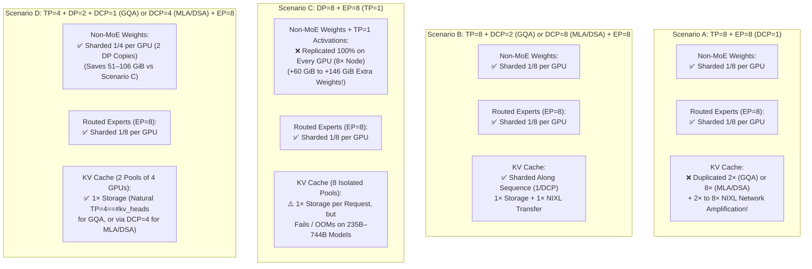
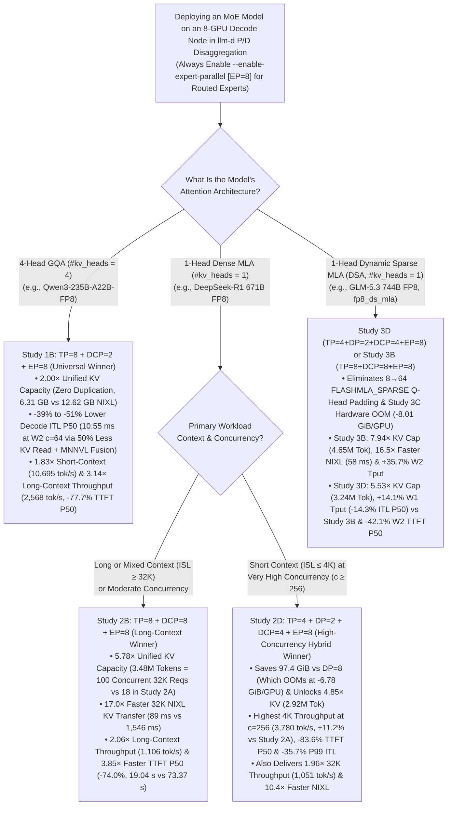

In Prefill/Decode (P/D) Disaggregated Serving with [llm-d](https://llm-d.ai), separating compute-bound Prefill pods from memory-bound Decode pods prevents long prompts from stalling token generation and lets operators tune parallelism for each phase independently. Yet when deploying large Mixture-of-Experts (MoE) models on an 8-GPU Decode node (8× NVIDIA H200 141GB) with Expert Parallelism (EP=8), a critical architectural trade-off emerges: standard Tensor Parallelism (TP=8) duplicates the KV cache 2× to 8× across GPUs and amplifies cross-node NIXL RDMA transfers, while pure Data Parallelism (DP=8, TP=1) replicates Non-MoE weights 8× across the node and runs out of HBM.

To overcome this bottleneck, vLLM supports [Decode Context Parallelism (DCP)](https://docs.vllm.ai/en/latest/serving/context_parallel_deployment/) (**--decode-context-parallel-size**), which shards each request's KV cache along the **sequence dimension** across GPUs inside a Tensor Parallel group instead of duplicating it. In this post, we show how enabling DCP on the Decode pool in llm-d P/D disaggregation resolves both the **TP KV duplication wall** and the **DP weight-replication OOM**. Across three flagship frontier MoE architectures — `Qwen/Qwen3-235B-A22B-FP8` (**4-Head GQA**), `deepseek-ai/DeepSeek-R1` (671B FP8, **Dense MLA**), and `zai-org/GLM-5.3` (744B FP8, **Dynamic Sparse MLA DSA**) — enabling DCP expands usable KV capacity by 2.0× to 7.94×, accelerates cross-node NIXL KV transfers by 16.5× to 17.0×, boosts long-context throughput by up to 3.14×, and slashes median Time-to-First-Token (TTFT P50) by 42% to 78%.

<!-- truncate -->

---

## The Decode Memory Dilemma in Disaggregated Serving

In llm-d's [P/D Disaggregation architecture](https://github.com/llm-d/llm-d/tree/main/guides/pd-disaggregation), the Inference Gateway and Endpoint Picker (EPP) route incoming prompts to a compute-optimized Prefill Pool, which computes the initial KV cache and transfers it over zero-copy RDMA (NixlConnector over UCX/RoCEv2) to a memory-optimized Decode Pool. While the **Routed Experts** (90%–97.5% of total MoE parameters) are naturally partitioned 1/8 per GPU across an 8-GPU Decode node using Expert Parallelism (EP = 8), operators must choose how to parallelize the **Non-MoE** layers (Attention projections, Lightning Indexers, Shared Experts, Dense MLPs, Embeddings, and LM Head) and the **KV cache**:

1. Why Standard `TP=8 + EP=8 (DCP=1)` Hits a KV Duplication & NIXL Transfer Wall:
   Standard Tensor Parallelism partitions attention strictly along the head dimension, which can split the KV cache at most **#kv_heads** ways:
   ```text
   KV Cache Duplication Factor under Standard TP = max(1, TP / #kv_heads)
   ```
   - On **4-Head GQA** (#kv_heads = 4, `Qwen3-235B-A22B-FP8`), TP=8 forces pairs of GPUs to store identical copies of each KV head (8 / 4 = 2× duplication, wasting 50% of KV HBM).
   - On **1-Head Dense MLA** (#kv_heads = 1, `DeepSeek-R1`) and **Dynamic Sparse MLA** (**DSA**, #kv_heads = 1, `GLM-5.3`), all query heads attend directly to a single shared compressed latent KV vector via matrix absorption. Because `#kv_heads = 1` cannot be split by head, TP=8 replicates the entire KV cache across all 8 GPUs (8 / 1 = 8× duplication, wasting 87.5% of KV HBM)!
   - Worse yet, in P/D disaggregation, every duplicated KV copy must be pulled across the network: for a single 32K-token prompt, an 8-GPU TP=8 Decode pod pulls 8× redundant KV bytes over NIXL/RoCEv2 (17.16 GiB/req on DeepSeek-R1; 13.17 GiB/req on GLM-5.3).

2. Why Pure `DP=8 + EP=8 (TP=1)` Runs Out of HBM on 235B–744B Models:
   Setting `DP=8, TP=1` eliminates KV duplication by running 8 independent single-GPU attention engines. However, without TP weight sharding, every GPU must replicate 100% of the Non-MoE weights (8× node-wide) — adding +59.5 GiB on `Qwen3-235B-A22B-FP8`, +130.1 GiB on `DeepSeek-R1`, and +145.7 GiB on `GLM-5.3` — while also allocating unsharded TP=1 runtime activations (22–37 GiB/GPU) and fragmenting KV memory into 8 isolated single-GPU pools.

---

## How Decode Context Parallelism (DCP) Works

**Decode Context Parallelism (DCP) (--decode-context-parallel-size**) resolves both bottlenecks by switching from head partitioning to **sequence-dimension partitioning** inside the TP group:



By setting `DCP = TP / #kv_heads` (DCP=2 for 4-head GQA at TP=8; DCP=8 for 1-head Dense/Sparse MLA at TP=8; or DCP=4 for 1-head MLA/DSA in hybrid TP=4, DP=2), each GPU stores only **1 / DCP** of each sequence's KV cache blocks:
- Zero KV Duplication: All 8 GPUs share a single KV cache pool (Scenario B) with 1× storage while keeping Non-MoE weights 1/8 sharded.
- 2× to 8× Less Per-Step KV HBM Bandwidth: On every decode step, each GPU reads only 1 / DCP of the sequence's KV blocks from HBM, computes local FlashAttention/FlashMLA with its local Log-Sum-Exp (LSE), and merges partial outputs across DCP ranks via a lightweight NVLink LSE combine.
- Sequence-Sharded NIXL KV Pull: When a Prefill pod finishes a prompt, each Decode GPU pulls only its assigned 1 / DCP sequence blocks over NixlConnector, eliminating redundant RDMA traffic.

---

## Benchmark Setup

We evaluated `Qwen/Qwen3-235B-A22B-FP8`, `deepseek-ai/DeepSeek-R1`, and `zai-org/GLM-5.3` on a 32-GPU GKE cluster (4× a3-ultragpu-8g nodes = 24 Prefill H200 141GB GPUs + 8 Decode H200 141GB GPUs, 3.2 Tbps RoCEv2 NICs, --max-model-len=40960) across two workloads (n = 3 iterations per concurrency level, resetting all Prefill/Decode prefix caches via POST /reset_prefix_cache and restarting pd-disaggregation-epp before every run):
- Short Context (W1): ISL = 4,096, OSL = 512 (4,608 peak tokens/req), Concurrency c ∈ {16, 64, 128, 256}.
- Long Context (W2): ISL = 32,768, OSL = 2,048 (34,816 peak tokens/req), Concurrency c ∈ {8, 16, 32, 64}.

---

## Case Study 1: Grouped-Query Attention (Qwen/Qwen3-235B-A22B-FP8)

`Qwen/Qwen3-235B-A22B-FP8` (235B total / 22B active parameters, 94 layers, 128 routed experts, top-8 active) uses **GQA** with **#kv_heads = 4** (64 query heads) and requires 192,512 B/token (188 KiB/token) of BF16 KV cache.

We benchmarked the 8-GPU Decode node under an 80 GB-equivalent memory ceiling (--gpu-memory-utilization=0.45 = 62.91 GiB/GPU, allocating 30.76 GiB/GPU to KV cache in `Study 1A`/`Study 1B`), plus 0.65\* (90.87 GiB/GPU) for `Study 1C*` because pure DP=8 (`Study 1C`) fails startup at 0.45:

| Metric (Qwen3-235B-A22B-FP8 on 8× H200 Decode) | Study 1A (TP=8 + EP=8, DCP=1, 0.45) | Study 1B (TP=8 + DCP=2 + EP=8, 0.45) | Study 1C (DP=8 + EP=8, TP=1, 0.45) | Study 1C\* (DP=8 + EP=8, TP=1, 0.65\*) | Study 1D (TP=4 + DP=2 + EP=8, DCP=1, 0.45) |
| :--- | :---: | :---: | :---: | :---: | :---: |
| Per-GPU HBM Cap (H200 139.8 GiB) | 62.91 GiB (0.45) | 62.91 GiB (0.45) | 62.91 GiB (0.45) | 90.87 GiB (0.65) | 62.91 GiB (0.45) |
| Non-MoE Weights | 1.23 GiB/GPU (9.8G node) | 1.23 GiB/GPU (9.8G node) | ❌ 8.67 GiB/GPU (69.3G node) | ❌ 8.67 GiB/GPU (69.3G node) | 2.25 GiB/GPU (18.0G node) |
| Routed Experts | 26.44 GiB/GPU (211.6G node) | 26.44 GiB/GPU (211.6G node) | 26.44 GiB/GPU (211.6G node) | 26.44 GiB/GPU (211.6G node) | 26.44 GiB/GPU (211.6G node) |
| Total Model Weights / GPU | 27.67 GiB | 27.67 GiB | ❌ 35.11 GiB | ❌ 35.11 GiB | 28.69 GiB |
| Non-Torch + Peak Activation + CUDA Graphs / GPU | 4.48 GiB | 4.48 GiB | ❌ 22.10 GiB | ❌ 22.10 GiB | 9.33 GiB |
| Available KV Cache Memory / GPU | ✅ 30.76 GiB | ✅ 30.76 GiB | ❌ 5.70 GiB | 33.66 GiB | ✅ 24.89 GiB |
| KV Cache Duplication Factor | ❌ 2× (48,128 B/tok/GPU) | ✅ 1× (24,064 B/tok/GPU) | 1× (Fails Startup) | 1× (192,512 B/tok/GPU) | ✅ 1× (48,128 B/tok/GPU) |
| Total Usable KV Capacity Across 8 GPUs | 686,272 tok (1.00×) | ✅ 1,372,640 tok (2.00×) | ❌ 0 tok (Fails Startup) | 1,501,824 tok (2.19×\*) | ✅ 1,110,400 tok (1.62×) |
| Max Concurrent W2 (34,816-tok) Requests | ❌ 19.7 reqs (1 pool) | ✅ 39.4 reqs (1 pool) | ❌ 0 reqs | 43.1 reqs (8 pools) | ✅ 31.9 reqs (2 pools) |
| Measured 32K NIXL KV Transfer Time (W2) | ❌ 1,506–1,714 ms (11.75 GiB/req) | ✅ 640–816 ms (5.88 GiB/req, 2.25× faster!) | Fails Startup | 778–1,104 ms (5.88 GiB/req, 1.73× faster) | ✅ 707–1,073 ms (5.88 GiB/req, 1.72× faster) |
| W1 c=256 (4K ISL) Output Throughput (tok/s) | 5,839.8 ± 48.2 | ✅ 10,695.0 ± 238.8 (1.83×) | Fails Startup | 6,460.0 ± 10.1 (1.11×\*) | ✅ 6,837.6 ± 111.9 (1.17×) |
| W2 c=64 (32K ISL) Output Throughput (tok/s) | ❌ 818.1 ± 3.1 | ✅ 2,568.4 ± 17.9 (3.14×) | Fails Startup | 1,147.9 ± 30.5 (1.40×\*) | ✅ 1,087.6 ± 141.5 (1.33×) |
| W1 c=256 (4K ISL) Decode ITL P50 (ms) | ❌ 32.33 ± 0.31 ms | ✅ 18.83 ± 0.13 ms (-41.8%) | Fails Startup | 31.67 ± 0.09 ms (-2.0%) | 31.92 ± 0.56 ms (-1.3%) |
| W2 c=64 (32K ISL) Decode ITL P50 (ms) | 20.42 ± 0.03 ms | ✅ 10.55 ± 0.08 ms (-48.3%) | Fails Startup | ❌ 26.37 ± 0.25 ms | ❌ 24.50 ± 0.11 ms |
| W1 c=256 (4K ISL) TTFT P50 (s) | ❌ 1.82 ± 0.41 s | ✅ 0.33 ± 0.02 s (-81.9%, 5.52× faster) | Fails Startup | 0.54 ± 0.10 s (-70.3%) | ✅ 0.47 ± 0.01 s (-74.2%) |
| W2 c=64 (32K ISL) TTFT P50 (s) | ❌ 52.81 ± 0.73 s | ✅ 11.79 ± 0.08 s (-77.7%, 4.48× faster) | Fails Startup | 11.96 ± 0.12 s (-77.4%) | ✅ 32.47 ± 0.21 s (-38.5%) |


### What the Qwen3-235B-A22B-FP8 Results Show

- `Study 1B` (`TP=8 + DCP=2 + EP=8`) Wins Every Metric on Both Short and Long Contexts: Because #kv_heads = 4, setting DCP = 2 requires only a 2-GPU intra-node NVLink LSE combine (< 0.4 ms total across 94 layers) to eliminate 2× GQA KV duplication, doubling KV capacity (1.37M vs. 686K tokens) and halving cross-node NIXL transfer volume (6.31 GB vs. 12.62 GB per 32K prompt).
- 39%–51% Lower Decode Median Inter-Token Latency (ITL P50): Halving per-GPU KV HBM reads (24.1 KiB/tok/GPU in `Study 1B` vs. 48.1 KiB/tok/GPU in `Study 1A`/`Study 1D` and 188.0 KiB/tok/GPU in `Study 1C*` — saving 13.01 GB/step/GPU at W2 c=16) while preserving DP=1, TP=8 FlashInfer MNNVL fused AllReduce+RMSNorm kernels allows `Study 1B` to sustain 9.75–10.55 ms ITL P50 (94.8–102.6 tok/s/user median) across W1 c≤64 and all W2 concurrencies (-48.3% at W2 c=64: 10.55 ms vs. 20.42 ms in `Study 1A`), delivering 10,695 tok/s at W1 c=256 (1.83× of `Study 1A`) and 2,568 tok/s at W2 c=64 (3.14× of `Study 1A`, -77.7% lower TTFT P50 at 11.79 s vs. 52.81 s).
- Why `DP=8 (TP=1) (Study 1C)` Fails Startup — And Even at 0.65\* Cap (`Study 1C*`), Trails `Study 1B` by 2.24×: At 0.45 cap, `Study 1C`'s +59.52 GiB Non-MoE weight replication and 22.10 GiB/GPU TP=1 activations leave 5.70 GiB/GPU for KV cache — less than the 7.34 GiB/GPU needed to hold a single 40,960-token sequence (ValueError). Even when granted +223.7 GiB extra node HBM (`Study 1C*` at 0.65\* cap), DP > 1 disables MNNVL AllReduce fusion and fragments KV cache into 8 isolated pools, losing to `Study 1B` by 1.66× on W1 (18.83 ms vs. 31.67 ms ITL P50 at c=256) and 2.24× on W2 (10.55 ms vs. 26.37 ms ITL P50 at c=64).

---

## Case Study 2: Dense Multi-head Latent Attention (deepseek-ai/DeepSeek-R1 671B)

`deepseek-ai/DeepSeek-R1` (671B total / 37B active parameters, native FP8 weights = 628.85 GiB single copy, 61 layers: 3 dense MLP + 58 MoE layers with 256 routed + 1 shared expert) uses **Dense MLA** with **#kv_heads = 1** (128 query heads, 70,272 B/token = 68.625 KiB/token BF16 KV cache).

Evaluating all four Decode topologies on 8× H200 (141 GB) at --gpu-memory-utilization=0.90 (125.82 GiB/GPU) exposes the stark contrast between 8× MLA KV duplication (`Study 2A`), DP=8 hardware OOM (`Study 2C`), sequence-sharded DCP=8 (`Study 2B`), and hybrid TP=4 + DP=2 + DCP=4 (`Study 2D`):

| Metric (DeepSeek-R1 671B FP8 on 8× H200, 0.90 Cap) | Study 2A (TP=8 + EP=8, DCP=1) | Study 2B (TP=8 + DCP=8 + EP=8) | Study 2C (DP=8 + EP=8, TP=1) | Study 2D (TP=4 + DP=2 + DCP=4 + EP=8) |
| :--- | :---: | :---: | :---: | :---: |
| Per-GPU HBM Cap (H200 139.8 GiB) | 125.82 GiB (0.90) | 125.82 GiB (0.90) | 125.82 GiB (0.90) | 125.82 GiB (0.90) |
| Non-MoE Weights | 3.45 GiB/GPU (27.6G node) | 3.45 GiB/GPU (27.6G node) | ❌ 19.71 GiB/GPU (157.7G node) | 7.54 GiB/GPU (60.3G node) |
| Routed Experts | 76.14 GiB/GPU (609.2G node) | 76.14 GiB/GPU (609.2G node) | 76.14 GiB/GPU (609.2G node) | 76.14 GiB/GPU (609.2G node) |
| Total Model Weights / GPU | ✅ 79.59 GiB | ✅ 79.59 GiB | ❌ 95.85 GiB | 83.68 GiB |
| Non-Torch + Peak Activation + CUDA Graphs / GPU | 6.77 GiB | 17.74 GiB | ❌ 36.75 GiB | 18.23 GiB |
| Available KV Cache Memory / GPU | ✅ 39.46 GiB | ✅ 28.49 GiB | ❌ -6.78 GiB (OOM) | 23.91 GiB |
| KV Cache Duplication Factor | ❌ 8× (70,272 B/tok/GPU) | ✅ 1× (8,784 B/tok/GPU) | 1× (OOM) | ✅ 1× (17,568 B/tok/GPU) |
| Total Usable KV Capacity Across 8 GPUs | 602,928 tok (1.00×) | ✅ 3,483,136 tok (5.78×) | ❌ 0 tok (OOM) | ✅ 2,922,752 tok (4.85×) |
| Max Concurrent W2 (34,816-tok) Requests | ❌ 17.3 reqs (1 pool) | ✅ 100.0 reqs (1 pool) | ❌ 0 reqs | ✅ 83.9 reqs (2 pools) |
| Measured 32K NIXL KV Transfer Time (W2) | ❌ 1,483–1,609 ms (17.16 GiB/req) | ✅ 83–95 ms (2.14 GiB/req, 17.0× faster!) | OOM | ✅ 145 ms (2.14 GiB/req, 10.4× faster!) |
| W1 c=256 (4K ISL) Output Throughput (tok/s) | 3,399.2 ± 43.4 | ✅ 3,495.0 ± 10.6 (+2.8%) | OOM | ✅ 3,779.5 ± 30.3 (+11.2%) |
| W2 c=64 (32K ISL) Output Throughput (tok/s) | ❌ 536.4 ± 6.4 | ✅ 1,106.3 ± 4.7 (2.06×) | OOM | ✅ 1,051.4 ± 1.0 (1.96×) |
| W1 c=256 (4K ISL) Decode ITL P50 (ms) | ✅ 59.97 ± 0.29 ms | 65.76 ± 0.10 ms | OOM | 60.37 ± 0.70 ms |
| W2 c=64 (32K ISL) Decode ITL P50 (ms) | ✅ 29.60 ± 0.38 ms | 41.77 ± 0.05 ms | OOM | 44.81 ± 0.04 ms |
| W1 c=256 (4K ISL) TTFT P50 (s) | ❌ 2.80 ± 0.58 s | ✅ 0.51 ± 0.01 s (-81.8%, 5.49× faster) | OOM | ✅ 0.46 ± 0.01 s (-83.6%, 6.09× faster) |
| W2 c=64 (32K ISL) TTFT P50 (s) | ❌ 73.37 ± 0.86 s | ✅ 19.04 ± 0.27 s (-74.0%, 3.85× faster) | OOM | ✅ 19.05 ± 0.28 s (-74.0%, 3.85× faster) |


### What the DeepSeek-R1 Results Show

- Pure `DP=8 + EP=8 (TP=1) (Study 2C)` Suffers a Hard Physical HBM OOM (-6.78 GiB/GPU): Replicating `DeepSeek-R1`'s 19.71 GiB of Non-MoE weights across all 8 GPUs consumes 95.85 GiB/GPU (+130.08 GiB node-wide), while unsharded TP=1 activations across 128 query heads + non-torch buffers (30.45 GiB/GPU) and CUDA graphs (6.30 GiB/GPU) reach 132.60 GiB/GPU before allocating a single KV cache block, crashing at startup with Available KV cache memory: -6.78 GiB.
- `Study 2B (TP=8 + DCP=8 + EP=8)` Speeds Up 32K NIXL Transfers by 17.0× and Doubles Long-Context Throughput (2.06×):
  - In `Study 2A (TP=8, DCP=1)`, all 8 Decode GPUs pull 100% of every 32K prompt's 2,196 MiB KV cache (17.16 GiB total across 124,928 NIXL descriptors/GPU), taking 1,483–1,609 ms. In `Study 2B (DCP=8)`, each GPU pulls only 1/8 of the sequence (274.5 MiB/GPU, 15,616 descriptors) in 83–95 ms (17.0× faster!), cutting W2 TTFT P50 by 1.31 seconds (2.10 s vs. 3.41 s, -38.4%) even at low concurrency (c=8).
  - At W2 c=16 (where both `Study 2A` and `Study 2B` run 16 active requests),`Study 2B` (545.3 tok/s, 24.72 ms ITL P50, 5.44 s TTFT P50) beats `Study 2A` (527.9 tok/s, 25.52 ms ITL P50, 6.69 s TTFT P50) on both throughput and median step latency because DCP=8 saves 30.97 GiB/GPU/step of HBM KV reads (~9.5 ms), outweighing the 61-layer DCP=8 collective!
  - At W2 c=64, `Study 2A` is pinned at its 18-request KV wall (99.9% KV, 46 waiting, 73.37 s TTFT P50), while `Study 2B` (3.48M tokens = 5.78× KV capacity) runs all 64 requests with 0 waiting, delivering 1,106.3 tok/s (2.06×), 19.04 s TTFT P50 (3.85× faster, -74.0%), and 106.63 s E2E P50 (-27.65 s faster vs. 134.28 s).
- Hybrid `Study 2D (TP=4 + DP=2 + DCP=4 + EP=8)` Wins High-Concurrency Short Context (3,779.5 tok/s, 0.46 s TTFT P50, -35.7% P99 ITL): Sharding Non-MoE weights 4-ways across DP=2 replicas saves 97.36 GiB vs. `Study 2C` (2.92M KV tokens = 4.85× of `Study 2A`) and replaces 8-GPU TP/DCP collectives with 4-GPU collectives across 61 layers — winning W1 c=256 throughput (+11.2% vs. `Study 2A`), cutting W1 c=256 TTFT P50 by -83.6% (0.46 s vs. 2.80 s), and slashing tail latency (61.32 ms vs. 95.41 ms P99 ITL).

---

## Case Study 3: Dynamic Sparse MLA (DSA) (zai-org/GLM-5.3 744B)

Next-generation frontier MoE models such as `zai-org/GLM-5.3` (GlmMoeDsaForCausalLM, ~744B total / ~40B active parameters, 78 layers, 256 routed experts) and `DeepSeek-V3.2` introduce **Dynamic Sparse Multi-head Latent Attention (DSA)**. Instead of attending to the full sequence of cached tokens on every decode step, `GLM-5.3` maintains two KV cache groups across all 78 layers (--kv-cache-dtype fp8_ds_mla):
1. FLASHMLA_SPARSE Cache (656 B/token/layer): Stores the 512-dim FP8 latent KV vector + 16 B scales + 64-dim BF16 RoPE key. During decode, FLASHMLA_SPARSE only gathers the index_topk = 2,048 selected tokens per query token (1.34 MB/layer).
2. DEEPSEEK_V32_INDEXER Cache (132 B/token/layer): Stores 128-dim FP8 Indexer keys + 4 B scale (61,464 B/token = 60.02 KiB/token combined across 78 layers). The lightweight 32-head Lightning Indexer scans the full sequence of this 132 B cache to select the top-2,048 token positions for FLASHMLA_SPARSE.

A natural question arises: Does **Dynamic Sparse Attention (DSA)** eliminate the need for DCP? Evaluating all four Decode topologies on 8× H200 (141 GB) at --gpu-memory-utilization=0.90 (125.82 GiB/GPU) proves why DCP remains essential:

| Metric (GLM-5.3 744B FP8 on 8× H200, 0.90 Cap) | Study 3A (TP=8 + EP=8, DCP=1) | Study 3B (TP=8 + DCP=8 + EP=8) | Study 3C (DP=8 + EP=8, TP=1) | Study 3D (TP=4 + DP=2 + DCP=4 + EP=8) |
| :--- | :---: | :---: | :---: | :---: |
| Per-GPU HBM Cap (H200 139.8 GiB) | 125.82 GiB (0.90) | 125.82 GiB (0.90) | 125.82 GiB (0.90) | 125.82 GiB (0.90) |
| Non-MoE Weights | ✅ 3.53 GiB/GPU (28.2G node) | ✅ 3.53 GiB/GPU (28.2G node) | ❌ 21.74 GiB/GPU (173.9G node) | 8.54 GiB/GPU (68.3G node) |
| Routed Experts | 86.80 GiB/GPU (694.4G node) | 86.80 GiB/GPU (694.4G node) | 86.80 GiB/GPU (694.4G node) | 86.80 GiB/GPU (694.4G node) |
| Total Model Weights / GPU | 90.33 GiB | 90.33 GiB | ❌ 108.54 GiB | 95.34 GiB |
| Non-Torch + Peak Activation + CUDA Graphs / GPU | 6.05 GiB | 6.29 GiB | ❌ 25.29 GiB | 10.13 GiB |
| Available KV Cache Memory / GPU | ✅ 29.44 GiB | ✅ 29.20 GiB | ❌ -8.01 GiB (OOM) | 20.35 GiB |
| KV Cache Duplication Factor | ❌ 8× (61,464 B/tok/GPU) | ✅ 1× (7,683 B/tok/GPU) | 1× (OOM) | ✅ 1× (15,366 B/tok/GPU) |
| Total Usable KV Capacity Across 8 GPUs | 585,920 tok (1.00×) | ✅ 4,649,984 tok (7.94×) | ❌ 0 tok (OOM) | ✅ 3,240,448 tok (5.53×) |
| Max Concurrent W2 (34,816-tok) Requests | ❌ 16.8 reqs (1 pool) | ✅ 133.6 reqs (1 pool) | ❌ 0 reqs | ✅ 93.1 reqs (2 pools) |
| Measured 32K NIXL KV Transfer Time (W2) | ❌ 908–1,086 ms (13.17 GiB/req) | ✅ 51–66 ms (1.65 GiB/req, 16.5× faster!) | OOM | ✅ ~105 ms (1.65 GiB/req, ~9.2× faster!) |
| W1 c=256 (4K ISL) Output Throughput (tok/s) | 3,040.4 ± 57.0 | ✅ 2,583.1 ± 53.8 | OOM | 2,948.4 ± 110.5 |
| W2 c=64 (32K ISL) Output Throughput (tok/s) | ❌ 622.7 ± 1.0 | ✅ 845.3 ± 0.9 (+35.7%) | OOM | ✅ 837.3 ± 3.3 (+34.5%) |
| W1 c=256 (4K ISL) Decode ITL P50 (ms) | ✅ 63.76 ± 0.78 ms | 77.37 ± 0.49 ms | OOM | ✅ 66.34 ± 0.36 ms |
| W2 c=64 (32K ISL) Decode ITL P50 (ms) | ✅ 23.96 ± 0.11 ms | 39.59 ± 0.03 ms | OOM | 39.60 ± 0.16 ms |
| W1 c=256 (4K ISL) TTFT P50 (s) | 1.99 ± 0.93 s | ✅ 0.90 ± 0.44 s (-54.8%, 2.21× faster) | OOM | ✅ 0.96 ± 0.59 s (-51.8%, 2.07× faster) |
| W2 c=64 (32K ISL) TTFT P50 (s) | ❌ 71.79 ± 0.20 s | ✅ 42.03 ± 0.43 s (-41.5%, 1.71× faster) | OOM | ✅ 41.59 ± 0.03 s (-42.1%, 1.73× faster) |


### What the GLM-5.3 (DSA) Results Show

- Why DSA Still Needs DCP — Sparse Attention Only Reduces What Each Decode Step Reads, Not What Must Be Stored or Transferred: Although DSA only attends to the top 2,048 tokens on each decode step, which 2,048 tokens are relevant changes dynamically with every new token generated. As a result, the Decode pod cannot discard any past tokens — it must still transfer the entire prompt's KV cache from Prefill over NIXL and keep the full history (61,464 B/token) in GPU memory. Without DCP, `Study 3A (TP=8, DCP=1)` still duplicates that entire KV cache 8× across all 8 GPUs (running out of KV memory at just 17 concurrent 32K requests, with 30 requests stuck waiting) and still pulls 8× redundant KV data over NIXL (13.17 GiB/req, taking 908–1,086 ms).
- `Study 3B (TP=8 + DCP=8)` & `Study 3D (TP=4 + DP=2 + DCP=4)` Eliminate 8→64 FLASHMLA_SPARSE Query-Head Padding: Because **GLM-5.3** has 64 query heads (8 local heads/GPU at TP=8), `Study 3A (DCP=1)` must pad query heads 8× (from 8 to 64) on every decode step to satisfy Hopper FLASHMLA_SPARSE's 64-head warpgroup tile (87.5% wasted MMA compute!). Both `Study 3B` (8 × 8 = 64 heads) and `Study 3D` (16 × 4 = 64 heads) gather exactly 64 query heads per DCP rank with zero padding.
- 7.94× KV Capacity Expansion (4.65M Tokens), 16.5× Faster NIXL (58 ms), +35.7% W2 Throughput, and -42.1% TTFT P50 (-52.1% P99): At W2 c=64, `Study 3B` (845.3 tok/s) and `Study 3D` (837.3 tok/s) break `Study 3A`'s 17-request wall (622.7 tok/s), cutting TTFT P50 from 71.79 s to 41.59–42.03 s (-41.5% to -42.1% P50, and -52.1% / >87 seconds faster at P99) and E2E P99 from 209.34 s to 154.35 s (-26.3%). Meanwhile, on high-concurrency short context (W1 c=256), `Study 3D` beats `Study 3B` by +14.1% (2,948.4 vs. 2,583.1 tok/s) with -14.3% lower ITL P50 (66.34 ms vs. 77.37 ms) via 4-GPU collectives while using 3.48× less KV memory than `Study 3A` (25.4% vs. 88.4%)!

---

## Choosing the Right Parallelism in Production



---

## Try It Yourself in llm-d

Enabling DCP in your llm-d [P/D Disaggregation deployment](https://github.com/llm-d/llm-d/tree/main/guides/pd-disaggregation) only requires adding **--decode-context-parallel-size** to your Decode worker arguments while keeping Prefill optimized for compute:

### 1. Qwen/Qwen3-235B-A22B-FP8 (TP=4 Prefill + TP=8, DCP=2 Decode)
```bash
# Prefill Worker (6 Pods × 4 GPUs: P_TP = #kv_heads = 4 -> Zero KV replication)
vllm serve Qwen/Qwen3-235B-A22B-FP8 \
  --tensor-parallel-size 4 \
  --enable-expert-parallel \
  --kv-transfer-config '{"kv_connector":"NixlConnector","kv_role":"kv_both"}'

# Decode Worker (1 Pod × 8 GPUs: TP=8 + DCP=2 + EP=8 -> 2.00x KV Capacity, 3.14x W2 Tput)
vllm serve Qwen/Qwen3-235B-A22B-FP8 \
  --tensor-parallel-size 8 \
  --decode-context-parallel-size 2 \
  --enable-expert-parallel \
  --kv-transfer-config '{"kv_connector":"NixlConnector","kv_role":"kv_both"}'
```

### 2. deepseek-ai/DeepSeek-R1 (TP=8 Prefill + TP=8, DCP=8 or Hybrid TP=4, DP=2, DCP=4 Decode)
```bash
# Prefill Worker (3 Pods × 8 GPUs: TP=8 + EP=8)
vllm serve deepseek-ai/DeepSeek-R1 \
  --tensor-parallel-size 8 \
  --enable-expert-parallel \
  --kv-transfer-config '{"kv_connector":"NixlConnector","kv_role":"kv_both"}'

# Decode Worker Option B (Long-Context Champion: 5.78x KV Capacity, 17x Faster NIXL, 2.06x W2 Tput)
vllm serve deepseek-ai/DeepSeek-R1 \
  --tensor-parallel-size 8 \
  --decode-context-parallel-size 8 \
  --enable-expert-parallel \
  --kv-transfer-config '{"kv_connector":"NixlConnector","kv_role":"kv_both"}'

# Decode Worker Option D (High-Concurrency Hybrid: TP=4 + DP=2 + DCP=4 + EP=8)
vllm serve deepseek-ai/DeepSeek-R1 \
  --tensor-parallel-size 4 \
  --data-parallel-size 2 \
  --data-parallel-size-local 2 \
  --decode-context-parallel-size 4 \
  --enable-expert-parallel \
  --kv-transfer-config '{"kv_connector":"NixlConnector","kv_role":"kv_both"}'
```

### 3. zai-org/GLM-5.3 (Dynamic Sparse MLA DSA — fp8_ds_mla + ag_rs)
```bash
# Decode Worker Option B (TP=8 + DCP=8 + EP=8 -> 7.94x KV Capacity, 16.5x Faster NIXL, +35.7% W2 Tput)
vllm serve zai-org/GLM-5.3 \
  --tensor-parallel-size 8 \
  --decode-context-parallel-size 8 \
  --dcp-comm-backend ag_rs \
  --enable-expert-parallel \
  --kv-cache-dtype fp8_ds_mla \
  --kv-transfer-config '{"kv_connector":"NixlConnector","kv_role":"kv_both"}'

# Decode Worker Option D (Hybrid TP=4 + DP=2 + DCP=4 + EP=8 -> +14.1% W1 Tput vs Study 3B & -42.1% W2 TTFT P50)
vllm serve zai-org/GLM-5.3 \
  --tensor-parallel-size 4 \
  --data-parallel-size 2 \
  --data-parallel-size-local 2 \
  --decode-context-parallel-size 4 \
  --dcp-comm-backend ag_rs \
  --enable-expert-parallel \
  --kv-cache-dtype fp8_ds_mla \
  --kv-transfer-config '{"kv_connector":"NixlConnector","kv_role":"kv_both"}'
```

---

## Conclusion

When deploying 200B–750B+ Mixture-of-Experts models in llm-d P/D disaggregation on 8-GPU nodes, we recommend **enabling Decode Context Parallelism (DCP)** on the Decode pod whenever **TP > #kv_heads**:
- On **4-Head GQA** MoE models (**#kv_heads = 4**, e.g., `Qwen3-235B-A22B-FP8`, `Qwen3-30B-A3B`): Configure the Decode pod with TP=8 + DCP=2 + EP=8 (Study 1B) to eliminate 2× KV cache duplication, double unified KV capacity, halve per-step KV HBM reads, and achieve up to 3.14× higher long-context throughput and 48% lower ITL P50.
- On **1-Head Dense MLA** (`DeepSeek-R1`) and **Dynamic Sparse MLA** (**DSA**, `GLM-5.3`) MoE models (**#kv_heads = 1**): Pure `DP=8 (TP=1)` (`Study 2C` / `Study 3C`) is physically impossible on 8× H200 (141 GB) due to +130 GiB to +146 GiB of replicated Non-MoE weights and unsharded TP=1 activations. Instead, enable `TP=8 + DCP=8 + EP=8` (`Study 2B` / `Study 3B`) for maximum KV capacity (5.78×–7.94×) and 16.5×–17.0× faster 32K NIXL KV transfers, or `TP=4 + DP=2 + DCP=4 + EP=8` (`Study 2D` / `Study 3D`) to combine zero KV duplication with smaller 4-GPU collectives at high concurrency.

At the same time, operators should note that not all models ship with DCP support in vLLM:
- Models Shipped with **DCP Support** in vLLM (supports_dcp = True):
  1. Pure Dense MLA (#kv_heads = 1, DCP ≤ TP): DeepSeek-V2 / V2-Lite / V2.5 / V3 / R1, Kimi-K2 / K2.5, GLM-4.7-Flash / GLM-4.5-Air, LongCat-Flash.
  2. Dynamic Sparse MLA (DSA, #kv_heads = 1, DCP ≤ TP with fp8_ds_mla): DeepSeek-V3.2 / V3.2-Exp, GLM-5 / 5.1 / 5.2 / 5.3, Hunyuan-V4.
  3. Hybrid Linear (KDA) + MLA (DCP ≤ TP): Kimi-Linear, GLM-5.3-Flash.
  4. GQA / MQA Full Attention (DCP ≤ TP / #kv_heads when TP > #kv_heads): Qwen3-30B-A3B and Qwen3-235B-A22B-FP8 (#kv_heads = 4 → DCP = 2 at TP = 8), or #kv_heads = 8 models (Llama-3.1-70B/405B, Mixtral, Qwen3-Next-80B) when deployed across nodes at TP ≥ 16 (at TP = 8, #kv_heads = 8 already has 1× KV storage without DCP).
- Models That **Do NOT Support DCP** in vLLM:
  - Models with Sliding Window Attention (SWA): Gemma-3 / Gemma-4, GPT-OSS, MiMo-V2-Flash, and DeepSeek-V4 / V4.1 (whose local SlidingWindowMLASpec layers conflict with interleaved DCP sequence-block sharding and raise AssertionError: DCP not support sliding window).
  - Custom Sparse Attention Backends Without DCP Kernels: Qwen4-Exp (custom Qwen Sparse Attention QSA) and MiniMax-M3 (custom block-sparse GQA indexer), which explicitly set supports_dcp = False.

---

## Get Involved

llm-d is an open-source, Kubernetes-native distributed inference stack built in collaboration with the vLLM community. To explore our disaggregated serving guides, reproduce these benchmarks, or contribute:

- GitHub Repository & P/D Disaggregation Guide: [github.com/llm-d/llm-d/tree/main/guides/pd-disaggregation](https://github.com/llm-d/llm-d/tree/main/guides/pd-disaggregation)
- Website & Documentation: [llm-d.ai](https://llm-d.ai)
- Related Reading:
  - [vLLM Documentation: Context Parallel Deployment (DCP)](https://docs.vllm.ai/en/latest/serving/context_parallel_deployment/)
  - [Efficient Decode Context Parallelism with vLLM for Long Context Workloads](https://vllm.ai/blog/2026-08-07-decode-context-parallelism)
